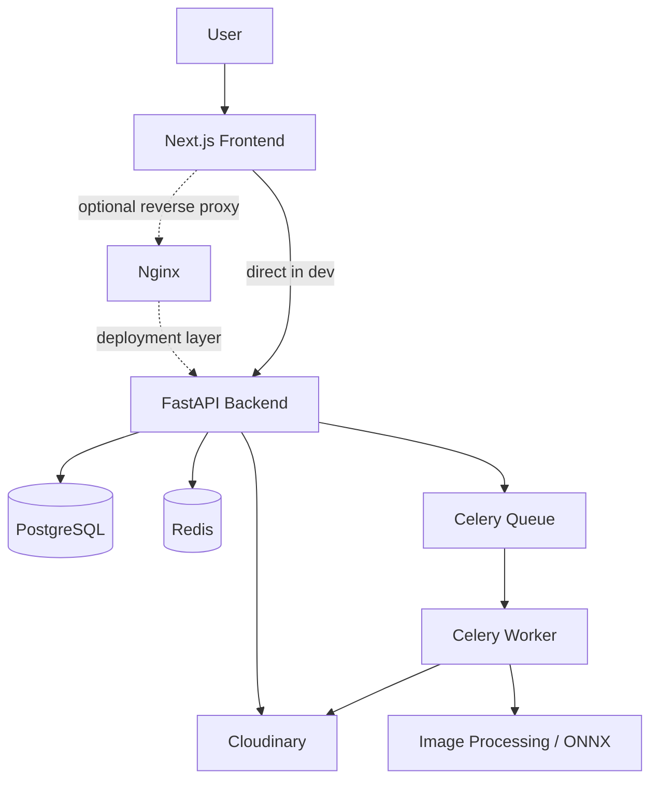

PROJECT.md doesn't cover ONNX model acquisition, so I'll add a short Model Setup section. Here's the final README with both corrections:

# PixelPilot

PixelPilot is an image-processing web application that brings image enhancement workflows into one interface. It combines a Next.js dashboard with a Python/FastAPI backend that handles image processing, asynchronous jobs, workflow execution, user accounts, credits, and notifications.

## Features

- **Image enhancement** — upscaling, denoising, and sharpening plugins
- **Workflow processing** — submit and track image-processing jobs and workflow stages
- **Asynchronous execution** — background processing through Celery and Redis
- **Image storage integration** — Cloudinary-backed storage
- **User accounts** — registration, authentication, and user APIs
- **Credits and notifications** — credit endpoints and notification functionality
- **Dashboard** — image workspace, job history, workflows, settings, and related UI
- **API** — versioned FastAPI endpoints with interactive docs
- **Testing** — backend pytest suite, frontend workflow-tracker tests, and Playwright browser tests

## Tech Stack

### Backend
- Python 3.11, FastAPI
- SQLAlchemy 2.0 (async), PostgreSQL
- Celery, Redis
- ONNX Runtime
- Cloudinary

### Frontend
- Next.js 14, React, TypeScript
- Tailwind CSS, Radix UI components
- Axios, Playwright

### Infrastructure & Tooling
- Docker / Docker Compose
- Nginx
- GitHub Actions

## Architecture



The frontend communicates with the backend APIs. Nginx may be used as an optional reverse-proxy layer in deployment; in local development the frontend typically connects to the backend directly. The backend manages application logic, validation, persistence, workflow state, and job submission. Celery workers handle background pipeline execution, while Redis supports the queue. Processed images are integrated with Cloudinary storage.

## Project Structure

```text
PixelPilot/
├── backend/                 # Python / FastAPI application
│   ├── app/
│   │   ├── ai/              # AI inference and tiling utilities
│   │   ├── api/v1/          # Versioned API endpoints (auth, images, jobs, workflows, etc.)
│   │   ├── core/            # Config, security, database, Redis, Celery
│   │   ├── models/          # Database models
│   │   ├── plugins/         # Image-processing plugins (denoise, sharpen, upscale)
│   │   ├── repositories/    # Data-access layer
│   │   ├── schemas/         # API request/response schemas
│   │   ├── services/        # Business logic and workflow services
│   │   └── workers/         # Celery pipeline tasks
│   ├── conftest.py
│   ├── test_pipeline_validation.py
│   ├── tests/               # Backend tests
│   ├── Dockerfile
│   ├── pyproject.toml
│   └── requirements.txt
├── frontend/                # Next.js application
│   ├── app/                 # App Router routes (login, register, dashboard, images, jobs, workflows, settings)
│   ├── components/          # Reusable UI components (dashboard, images, jobs, layout, workflow, ui)
│   ├── context/             # React contexts (auth, accent, toast)
│   ├── hooks/               # Custom hooks
│   ├── lib/                 # API clients and services
│   ├── tests/               # Frontend unit tests
│   ├── playwright-tests/    # Playwright browser tests
│   └── screenshots/         # Visual regression baselines and references
├── nginx/                   # Nginx configuration
├── docs/                    # Project documentation
├── docker-compose.yml
├── Makefile
├── .env.example
├── PROJECT.md
└── README.md
```

## Getting Started

### Prerequisites

- Docker
- Docker Compose
- Git

Some image-processing functionality may require downloading or configuring model files used by the backend.

### 1. Clone the repository

```bash
git clone <repository-url>
cd PixelPilot
```

### 2. Configure environment variables

Create your local environment file from the example:

```bash
cp .env.example .env
```

Edit `.env` and provide the required values for the services and integrations. **Do not commit `.env` or real credentials.**

### 3. Start the application

Use Docker Compose:

```bash
docker compose up --build
```

- API: `http://localhost:8000/api/v1/docs`
- Frontend: `http://localhost:3000`

If the project defines additional setup steps, model-download requirements, or service-specific configuration, consult `PROJECT.md` before starting.

## Model Setup

Image enhancement relies on ONNX model files used by the backend AI plugins (upscale, denoise, sharpen). These model binaries are **not** included in the repository.

Before running image-processing jobs:

1. Download the required ONNX model files according to your backend plugin configuration.
2. Place them in the location expected by `backend/app/ai/` (see `PROJECT.md` and `.env.example` for path settings).
3. Add any model-path or model-version variables to your `.env` file.

Do not commit large model binaries to the repository.

## Testing

PixelPilot includes backend tests (pytest) and frontend tests (workflow-tracker unit tests and Playwright browser tests).

Run tests using the commands documented in the project configuration and `PROJECT.md`. Tests that depend on external services, Docker, credentials, model files, or browser setup may require those dependencies to be available.

## Configuration and Secrets

- Use `.env.example` as the reference for environment variables.
- Keep `.env` local and never commit it.
- Never commit API keys, tokens, passwords, private credentials, or user data.
- Keep large model binaries out of the source repository; follow the project's model setup instructions.

## Documentation

- [`PROJECT.md`](PROJECT.md) — project-specific instructions and setup notes.
- [`docs/ARCH_OVERVIEW.md`](docs/ARCH_OVERVIEW.md) — architecture overview.

## License

MIT License. See [LICENSE](LICENSE) for details.
